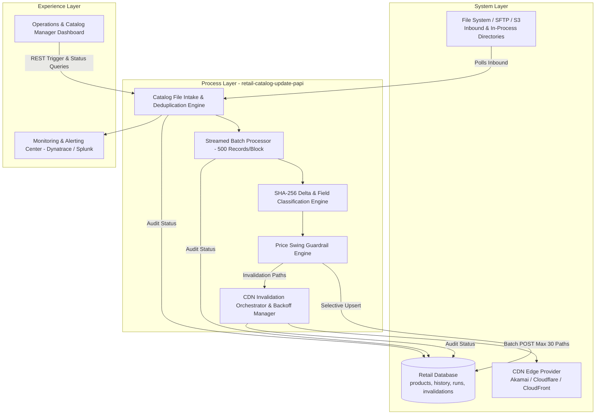
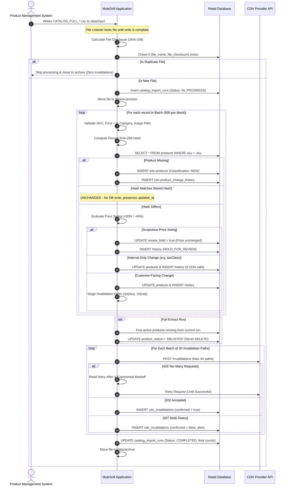

# High Level Design (HLD) Document
## Retail Real-Time Product Catalog Update API
**Hackathon Challenge:** 2027 Nurture Partner Network (NPN) MuleSoft Hackathon  
**Architecture Style:** API-Led Connectivity (Process API Layer)  
**Runtime:** MuleSoft Mule Runtime 4.4+ / Anypoint Studio 7.x  

---

## 1. Executive Summary & Architecture Overview

This project implements an enterprise-grade, high-throughput MuleSoft integration that automates retail catalog updates from flat file extracts. It features **streaming batch ingestion**, **O(1) SHA-256 change detection**, **intelligent customer-facing vs. internal delta classification**, **price swing guardrails**, **selective non-destructive database updates**, and **rate-limited CDN cache invalidation**.

### API-Led Connectivity Architecture

---

## 2. Component Design & Responsibilities

| Component | Flow / File | Core Responsibility |
| :--- | :--- | :--- |
| **Intake & Checksum Guard** | `catalog-intake-flow.xml` | Ingests CSVs via File Listener, verifies file lock (`timeBetweenSizeCheck`), calculates SHA-256 file checksum, rejects duplicates. |
| **Streamed Batch Processing** | `catalog-processing-flow.xml` | Uses `<batch:job>` with block size 500. Processes records as streams to prevent JVM memory exhaustion. |
| **Validation Engine** | `validate-record.dwl` | Validates mandatory fields, regex formats, positive pricing, and enum constraints. |
| **Delta Classifier** | `classify-delta.dwl` | Computes SHA-256 hash across 10 business fields. Categorizes into `NEW`, `UNCHANGED`, `CHANGED_CUSTOMER_FACING`, `CHANGED_INTERNAL_ONLY`. |
| **Price Guardrail** | `price-guard-check.dwl` | Evaluates price swing. Increases >50% or decreases >40% trigger `HOLD_FOR_REVIEW` without altering stored price. |
| **Selective Persistence** | `catalog-persistence-flow.xml` | Writes only `NEW` and `CHANGED` rows; preserves `UNCHANGED` timestamps. Records all diffs to `product_change_history`. |
| **Delisting Engine** | `catalog-persistence-flow.xml` | Full extract runs mark missing active records as `DELISTED` (never physical delete) subject to safety record counts. |
| **CDN Invalidation Engine** | `cdn-invalidation-flow.xml` | Batches paths (max 30), calls CDN API, implements HTTP 429 backoff retry, tracks HTTP 207 partial responses. |
| **Global Error Handler** | `global-error-handler.xml` | Centralized recovery for DB, HTTP, and File errors. Ensures CDN failure never rolls back valid DB commits. |

---

## 3. End-to-End Sequence Diagram

---

## 4. Delta Classification Matrix

| Existing in DB? | Hash Matches Stored? | Changed Fields | Price Swing Normal? | Resulting Classification | DB Action | CDN Invalidation? |
| :---: | :---: | :---: | :---: | :---: | :---: | :---: |
| **No** | N/A | All | N/A | `NEW` | `INSERT` | **Yes** |
| **Yes** | **Yes** | None | N/A | `UNCHANGED` | **None** (Untouched) | **No** |
| **Yes** | **No** | `taxClass`, `categoryCode`, `brand` | Yes | `CHANGED_INTERNAL_ONLY` | `UPDATE` | **No** |
| **Yes** | **No** | `productName`, `price`, `stockStatus`, `imagePath` | Yes | `CHANGED_CUSTOMER_FACING` | `UPDATE` | **Yes** |
| **Yes** | **No** | `price` | **No** (+60% or -90%) | `HOLD_FOR_REVIEW` | `UPDATE review_hold` | **No** |
| **Yes (Active)** | N/A (Missing from Full File) | N/A | N/A | `DELISTED` | `UPDATE status` | **Yes** |

---

## 5. Security & Production Best Practices

1. **Auto-Discovery & API Gateway**: Managed via Anypoint API Manager using `api-gateway:autodiscovery` with standard Client ID Enforcement and Rate Limiting SLA tiers.
2. **Secure Credentials**: Sensitive credentials (`cdn.api.token`, DB credentials) protected via Mule Secure Configuration Properties (`mule-artifact.json`).
3. **Resilience & Transaction Independence**: CDN outages never roll back successfully committed database catalog changes. Pending invalidations are persisted and retried asynchronously.
4. **Structured JSON Logging**: Every transaction is logged with `correlationId`, `runId`, and timestamp for automated ingestion into Splunk/ELK.
